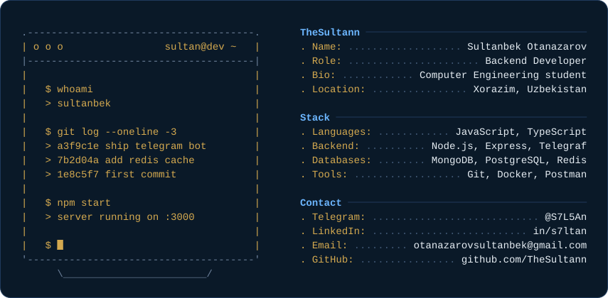

<div align="center">



<p align="center">
  <em>Building scalable backend systems and intelligent automation solutions</em>
</p>

</div>

---

## 💫 About Me

```javascript
const sultan = {
    role: "Backend Developer",
    location: "Xorazim, Uzbekistan 🇺🇿",
    specialization: ["Node.js", "Express.js", "Telegram Bots", "API Design"],
    currentFocus: "Building scalable microservices and intelligent automation",
    interests: ["EdTech", "AI Integration", "Clean Architecture", "DevOps"],
    motto: "Clean code is not written by following a set of rules. 
            You know you are working on clean code when it reads like prose."
};
```

🔭 **Currently Working On:** AI-powered educational tools and business automation bots  
🌱 **Learning:** Advanced TypeScript patterns, microservices architecture, and cloud technologies  
🤝 **Open to Collaborate:** Telegram bots, Backend APIs, EdTech platforms, AI integrations  
⚡ **Fun Fact:** I believe every backend should be as elegant as its frontend counterpart

---

## 🛠️ Tech Stack

### Languages


### Backend & Frameworks


### Databases & Storage


### Tools & Technologies


### AI & Cloud Services


---

## 🚀 Featured Projects

<table>
<tr>
<td width="50%">

### 🎓 [HEMIS-Notify](https://github.com/TheSultann/hemis-notify)
**Automated University Schedule Notification System**

- 📅 Integration with HEMIS university system
- 🤖 Smart Telegram bot with auto-scheduling
- ⏰ Daily notifications at 7:00 AM & 7:00 PM
- 🔐 Secure authentication & data encryption

**Tech:** Node.js, MongoDB, Telegram Bot API, Express

</td>
<td width="50%">

### 📚 [SpeakCheck Bot](https://github.com/TheSultann/SpeakCheck)
**AI-Powered English Grammar & IELTS Practice**

- 🤖 Google Gemini AI for grammar correction
- 🗣️ Speech-to-Text with Google Cloud API
- 📝 IELTS Speaking practice (Parts 1, 2, 3)
- ✅ Real-time feedback & corrections

**Tech:** Node.js, Telegraf, Google AI, Google Cloud

</td>
</tr>
<tr>
<td width="50%">

### 🥧 [PieStat Bot](https://github.com/TheSultann/PieTrack-A)
**AI-Powered Sales Tracker for Small Business**

- 📊 Automated sales & inventory tracking
- 🤖 AI-powered production forecasting
- 📈 Financial analytics & reporting
- ⏰ Automated daily reports

**Tech:** Node.js, Supabase, Google Gemini, Cron

</td>
<td width="50%">

### 🎓 [Learning Platform](https://github.com/TheSultann/learning-platform)
**Full-Stack Educational Management System**

- 👥 Multi-role system (Admin, Teacher, Student)
- 📊 Financial management & analytics
- 📈 Interactive data visualization
- ⚡ Redis caching for 10-20x performance

**Tech:** MERN Stack, Redis, BullMQ, Chart.js

</td>
</tr>
</table>

---

## 📊 GitHub Statistics

<div align="center">
  


</div>

<div align="center">
  


</div>

---

## 💼 What I Can Help You With

<table>
<tr>
<td width="33%" align="center">

### 🤖 Telegram Bots
Intelligent automation, business tools, educational bots with AI integration

</td>
<td width="33%" align="center">

### 🔧 Backend APIs
RESTful APIs, microservices, database design, authentication systems

</td>
<td width="33%" align="center">

### 🎓 EdTech Solutions
Learning platforms, management systems, student tracking, analytics

</td>
</tr>
</table>

---

## 🎯 Current Goals

- 🚀 Master **microservices architecture** and **Docker containerization**
- 🤖 Build more AI-integrated automation tools
- 📚 Contribute to open-source projects
- 🌐 Expand knowledge in **cloud technologies** (AWS/GCP)
- 📊 Learn advanced **data analytics** and visualization

---

## 📫 Let's Connect!

<div align="center">

### I'm always open to interesting conversations and collaboration opportunities!

[](https://t.me/S7L5An)
[](mailto:otanazarovsultanbek@gmail.com)
[](https://www.linkedin.com/in/s7ltan)

</div>

---

<div align="center">

### 💭 Developer's Wisdom

*"First, solve the problem. Then, write the code."* — John Johnson

*"Code is like humor. When you have to explain it, it's bad."* — Cory House

---


**Thank you for visiting! Feel free to explore my repositories and don't hesitate to reach out!** 🚀

</div>
